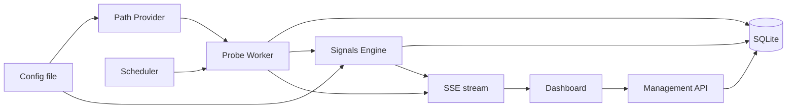

# Connectivity Monitor — Architecture (v0)

## Purpose

A personal-use tool for continuous, multi-path monitoring of the
reachability and integrity of arbitrary internet endpoints. Its job is
to capture raw evidence of how network paths behave — latency, TLS
handshake details, response characteristics, DNS answers, failure
modes — across a user-defined set of routes (direct, via a VPN, via a
DPI-bypass proxy, through a remote jumpbox, etc.) and present that
evidence continuously in a live dashboard.

The ethos is borrowed from OONI probe: **capture widely, interpret
later.** This tool is not primarily an alerting system; it is a
diagnostic observatory.

### Pivot context

This project was originally drafted as a hackathon submission
("Operational Continuity Agent") targeting corporate SREs: hardcoded
RU/EU OpenConnect VPN labels, Mattermost alert threading, an LLM
agent producing fixed-enum diagnoses. With the hackathon off the
table, the design has been re-pointed at personal use. This
document is the post-pivot v0 architecture; `PATH_DEPLOYMENTS.md`
("Reference path deployments") is its first sub-document.

## Non-goals for v1

- **LLM integration of any kind.** Qualitative diagnostics come from
  deterministic heuristic rules instead. LLM-authored explanatory
  reports are a candidate later-phase feature.
- **Webhooks, push notifications, external messaging integrations**
  (Mattermost, Slack, email, ntfy, etc.). The only surface is the
  dashboard.
- **Alert dampening, on-call workflows, incident management.**
- **Hardcoded knowledge of any specific VPN, proxy, or transport.**
  No `CORPORATE_VPN` path, no `DPI_BYPASS` path. Paths are purely
  user-defined.
- **A fixed diagnosis enum.** Diagnostic outputs are tagged,
  open-ended signals.
- **Cloud deployment, multi-user, authentication.** Single-user,
  locally-run.

## Core concepts

**Target.** An internet endpoint to monitor. Minimally a URL
(protocol + host + path) with a human-readable label. Targets are
user-managed via the dashboard.

**Path.** A named route through which the tool reaches the internet.
From the application's perspective, a path is a named SOCKS5 URL (or
the special value "no proxy — use the host's default routing"). Paths
are user-defined; the system ships zero hardcoded labels.
Implementations are out-of-scope for the app itself: the user stands
up whatever they want — a container running OpenConnect+oathtool, a
WireGuard-via-SOCKS sidecar, a remote `ssh -D` tunnel, a bare
shadowsocks server — and tells the tool the SOCKS5 URL plus any
descriptive tags.

**Probe.** A single check of a single target over a single path at a
specific time. Produces a structured outcome: success/failure, timing
breakdown, and a rich JSON payload of raw evidence (DNS answers, TLS
handshake details, response headers, failure mode, optionally body
size/hash). Probes are the atom of everything downstream.

**Signal.** A tagged observation produced by a deterministic rule
evaluating probe data. Signals can be per-probe (e.g. "response
truncated at a suspicious size boundary") or cross-probe (e.g. "TLS
cert fingerprint differs across paths for the same target over the
last N probes"). Signals carry a name, a confidence score, and an
evidence pointer to the probes that triggered them. Signals do not
collapse into a single enum — a target can have several concurrent
active signals, and new rules can be added without schema change.

## Data flow

### Probe data flow (server-driven, one direction)

1. The **scheduler** (in-process, cron-like) fires every configured
   interval.
2. For each target, the **probe worker** dispatches one probe per
   configured path, concurrently. Each probe opens a connection
   through its path's SOCKS5 URL (or direct), performs the configured
   check types (HTTP GET at minimum; optionally DNS-only lookup,
   TCP-connect-only), captures raw evidence, and returns an outcome.
3. Each probe outcome is persisted: hot columns (target, path,
   timestamp, success, total duration) plus a JSON payload blob.
4. The **signals engine** evaluates the new probe — along with recent
   history for that target — against its rule set, persisting any
   fresh signals.
5. The **SSE layer** pushes delta events to connected dashboard
   clients: one event per probe, one per signal. The dashboard's
   matrix view updates cell state accordingly.

### Configuration and command flow (inbound)

Two distinct inbound channels feed the system:

- **Static configuration** — path definitions, signal rule tuning
  constants (thresholds, suspicious-size boundaries, time windows),
  cadence defaults, server port. Read from a config file at startup.
  File-based for v1 by design: paths are not managed through the UI,
  and tuning is a deliberate act, not a runtime knob. Reload
  semantics are deferred to the config sub-document.
- **Target management** — add / label / remove targets. A runtime
  operation through the dashboard: HTTP POST to management
  endpoints, writing to storage, which the probe worker picks up at
  the next scheduler tick. Targets are the one entity that changes
  often enough to justify a UI.

SSE (server → UI) and management HTTP (UI → server) are separate
one-way channels, not a shared bidirectional pipe.

## Component architecture

All components live in a single process.

**Probe engine.** Runs scheduled probes. Holds no persistent state
beyond in-flight probe futures. Takes a `(target, path)` as input;
produces a probe outcome. Delegates HTTP/TLS/DNS mechanics to a thin
wrapper over Bun's HTTP and `tls` primitives, plus a SOCKS5 agent.
Check types (`http_get`, `dns_lookup`, `tcp_connect`) are the
extensibility seam.

**Path provider.** Reads path definitions from the config file at
startup and exposes the live list to the probe engine. The app does
not start, stop, or health-check the proxy processes themselves —
that is the user's responsibility. Reference deployment recipes ship
alongside as worked examples, not runtime dependencies.

**Storage.** SQLite via `bun:sqlite`. Tables for targets, probes
(with a JSON payload column absorbing schema evolution), and
signals. Retention policy and rollup strategy deferred to a
sub-document. Note: paths are *not* stored in the database in v1;
they live in the config file and are re-read on restart.

**Signals engine.** A set of pure functions, each evaluating some
slice of probe data and returning 0..n signals. Runs after each
probe. Rules are plain TypeScript modules; adding a rule means
adding a function — no schema change, no registration ceremony.
Tuning constants for rules live in the config file, not in code.

**API + SSE layer.** SvelteKit server routes. JSON endpoints for
CRUD on targets, plus an SSE endpoint streaming probe and signal
deltas. SvelteKit form actions back the management UI. Paths are
not managed through this API in v1 (they come from the config
file).

**Dashboard.** SvelteKit frontend. Primary view is a target × path
matrix with live status cells. Secondary views (per-probe drill-in,
target time-series, signal browser) are deferred to the dashboard
sub-document. Styling and primitives via Shoelace web components. A
responsive layout is an architectural baseline — the dashboard is
expected to be usable from a phone (typical scenario: the tool
running on a home server, monitored from a phone on the same
network).

## Technology choices

**Bun runtime.** Chosen over Node primarily to get `bun:sqlite`
(native, no native-bindings bundling pain), first-class TypeScript
execution without a separate compile step, single-binary deployment
via `bun build --compile`, and a cleaner fetch/tls API surface.
TypeScript throughout.

**SvelteKit, as a monolith.** One repo, one process: the probe
engine, the JSON/SSE API, and the UI all live inside one SvelteKit
project. Rationale: the OONI-ish data trajectory (time-series views,
cross-filtering, per-probe drill-in) will want a component framework
sooner rather than later, and SvelteKit's form actions cover the
management surface cleanly without bespoke glue. `adapter-bun` for
production builds.

**bun:sqlite.** Single-file DB, zero deployment friction, more than
fast enough for the probe throughput at hand.

**Shoelace / Web Awesome.** Web-components UI library. Drops in as
HTML tags, framework-neutral, covers the dashboard primitives
(badges, dialogs, tabs, dropdowns, tooltips) without dragging in
Tailwind or a shadcn-style toolchain. Interoperates with Svelte
without wrapping.

## Deployment shape

One Bun + SvelteKit process. Runs locally or on a small VPS. Reads
and writes one SQLite file plus one config file. Serves the
dashboard on a port.

Separately, the user runs whatever proxy containers or services they
want; each exposes a SOCKS5 port that a path definition references.
The tool does not orchestrate those containers.

Reference proxy deployments (an OpenConnect+oathtool Dockerfile, a
WireGuard-via-SOCKS recipe, etc.) ship alongside as worked examples,
not dependencies.

## Sub-documents

Specific areas factored out of this document for independent
iteration. Each becomes its own file.

### Written

- **Reference path deployments** (`PATH_DEPLOYMENTS.md`). The path
  contract, the `role` / `tags` schema, DNS policy default, secrets-
  handling patterns, and a cookbook of Dockerfiles + compose recipes
  for recommended proxy setups (OpenConnect+oathtool+libsecret,
  SpoofDPI, Tor, …).
- **Probe payload specification** (`PROBE_PAYLOAD.md`). The three
  check types (`http_get` / `dns_lookup` / `tcp_connect`), the
  per-hop JSON shape of `http_get` (OONI-inspired field names,
  Playwright-native per-hop structure), flat shapes for the simpler
  two, the `reached_stage` + `termination_mode` + per-op `failure`
  factual model, body-shape signals, and the error-code taxonomy.

### Pending

- **Storage schema.** Column-level detail, indexes, retention
  policy, rollup / downsampling strategy.
- **Signal rule catalogue.** The first-pass rules (response-size
  cutoff at suspicious boundaries, TLS truncation, DNS private-IP
  returns, RST-after-ClientHello, cross-path cert fingerprint
  divergence, etc.) and the rule module convention.
- **API / SSE event shape.** JSON wire formats for endpoints and
  streaming events.
- **Dashboard view inventory.** Matrix, drill-in, timeline, signal
  browser. Navigation and interaction details.
- **Configuration file format.** Exact schema of the static config
  file (path definitions, signal rule tuning constants, cadence
  defaults, server port), file format choice (TOML / YAML / JSON),
  and reload semantics.

## Out of scope entirely

Multi-user operation. Authentication. Cloud-native deployment. Any
alerting story beyond the dashboard. LLM integration. Long-term
time-series analytics beyond what the dashboard surfaces directly.

---

*Status: v0 draft. Expect revisions as sub-documents surface
decisions that ripple upward.*
