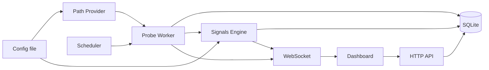

# Connectivity Monitor — Architecture (v0)

## Purpose

A personal-use tool for continuous, multi-path monitoring of the
reachability and integrity of arbitrary internet endpoints. Its job is
to capture raw evidence of how network paths behave — latency, TLS
handshake details, response characteristics, DNS answers, failure
modes — across a user-defined set of routes (direct, via a VPN, via a
DPI-bypass proxy, through a remote jumpbox, etc.) and present that
evidence continuously in a live dashboard.

The ethos is borrowed from OONI probe: **capture widely, interpret
later.** This tool is not primarily an alerting system; it is a
diagnostic observatory.

### Pivot context

This project was originally drafted as a hackathon submission
("Operational Continuity Agent") targeting corporate SREs: hardcoded
RU/EU OpenConnect VPN labels, Mattermost alert threading, an LLM
agent producing fixed-enum diagnoses. With the hackathon off the
table, the design has been re-pointed at personal use. This
document is the post-pivot v0 architecture; `PATH_DEPLOYMENTS.md`
("Reference path deployments") is its first sub-document.

## Non-goals for v1

- **LLM integration of any kind.** Qualitative diagnostics come from
  deterministic heuristic rules instead. LLM-authored explanatory
  reports are a candidate later-phase feature.
- **Webhooks, push notifications, external messaging integrations**
  (Mattermost, Slack, email, ntfy, etc.). The only surface is the
  dashboard.
- **Alert dampening, on-call workflows, incident management.**
- **Hardcoded knowledge of any specific VPN, proxy, or transport.**
  No `CORPORATE_VPN` path, no `DPI_BYPASS` path. Paths are purely
  user-defined.
- **A fixed diagnosis enum.** Diagnostic outputs are tagged,
  open-ended signals.
- **Cloud deployment, multi-user, authentication.** Single-user,
  locally-run.

## Core concepts

**Target.** An internet endpoint to monitor. Minimally a URL
(protocol + host + path) with a human-readable label. Targets are
user-managed via the dashboard.

**Path.** A named route through which the tool reaches the internet.
From the application's perspective, a path is a named SOCKS5 URL (or
the special value "no proxy — use the host's default routing"). Paths
are user-defined; the system ships zero hardcoded labels.
Implementations are out-of-scope for the app itself: the user stands
up whatever they want — a container running OpenConnect+oathtool, a
WireGuard-via-SOCKS sidecar, a remote `ssh -D` tunnel, a bare
shadowsocks server — and tells the tool the SOCKS5 URL plus any
descriptive tags.

**Probe.** A single check of a single target over a single path at a
specific time. Produces a structured outcome: success/failure, timing
breakdown, and a rich JSON payload of raw evidence (DNS answers, TLS
handshake details, response headers, failure mode, optionally body
size/hash). Probes are the atom of everything downstream.

**Signal.** A tagged observation produced by a deterministic rule
evaluating probe data. Signals can be per-probe (e.g. "response
truncated at a suspicious size boundary") or cross-probe (e.g. "TLS
cert fingerprint differs across paths for the same target over the
last N probes"). Signals carry a name, a confidence score, and an
evidence pointer to the probes that triggered them. Signals do not
collapse into a single enum — a target can have several concurrent
active signals, and new rules can be added without schema change.

## Data flow

### Probe data flow (server-driven, one direction)

1. The **scheduler** (in-process, via `croner`) fires every
   configured interval. The scheduler enforces no-overlap semantics
   — the next firing is held until the prior handler's Promise
   settles — to keep slow probes from queuing on top of each other.
2. For each target, the **probe worker** dispatches one probe per
   configured path, concurrently. Each probe opens a connection
   through its path's SOCKS5 URL (or direct), performs the configured
   check types (HTTP GET at minimum; optionally DNS-only lookup,
   TCP-connect-only), captures raw evidence, and returns an outcome.
3. Each probe outcome is persisted to the `probes` table: hot
   columns (target, path, check type, timestamp, runtime, reached
   stage, first failure code, …) plus the full payload as a JSON
   blob. See `STORAGE_SCHEMA.md` for the column-level detail and
   `PROBE_PAYLOAD.md` for the payload structure.
4. The **signals engine** evaluates the new probe — along with recent
   history for that target — against its rule set, persisting any
   fresh signals.
5. The **WebSocket layer** pushes delta events to connected
   dashboard clients: one message per probe insertion, one per
   signal transition, one per target mutation. The dashboard's
   matrix view updates cell state accordingly. See `API.md` for
   message types and shapes.

### Configuration and command flow (inbound)

Two distinct inbound channels feed the system:

- **Static configuration** — path definitions, signal rule tuning
  constants (thresholds, suspicious-size boundaries, time windows),
  cadence defaults, server port. Read from a config file at startup.
  File-based for v1 by design: paths are not managed through the UI,
  and tuning is a deliberate act, not a runtime knob. Reload
  semantics are deferred to the config sub-document.
- **Target management** — add / label / remove targets. A runtime
  operation through the dashboard: HTTP POST to management
  endpoints, writing to storage, which the probe worker picks up at
  the next scheduler tick. Targets are the one entity that changes
  often enough to justify a UI.

The WebSocket carries server → client deltas; the HTTP API carries
UI → server mutations and on-demand reads. WS is structurally
bidirectional but v0 uses it server-push only; client-originated
WS messages are reserved for future subscriptions / filters.

## Component architecture

All components live in a single process.

**Probe engine.** Runs scheduled probes. Holds no persistent state
beyond in-flight probe futures. Takes a `(target, path)` as input;
produces a probe outcome. `http_get` is backed by Playwright (see
`PROBE_PAYLOAD.md`); `dns_lookup` and `tcp_connect` go through
`node:dns` and `node:net` respectively. Check types (`http_get`,
`dns_lookup`, `tcp_connect`) are the extensibility seam.

**Path provider.** Reads path definitions from the config file at
startup and exposes the live list to the probe engine. The app does
not start, stop, or health-check the proxy processes themselves —
that is the user's responsibility. Reference deployment recipes
ship alongside as worked examples in `PATH_DEPLOYMENTS.md`, not as
runtime dependencies.

**Storage.** SQLite via `node:sqlite`. Tables for targets, probes
(with a JSON payload column absorbing schema evolution), and
signals. Schema, indexes, retention policy, and lifecycle details
in `STORAGE_SCHEMA.md`. Paths are *not* stored in the database in
v1; they live in the config file and are re-read on restart.

**Signals engine.** A set of pure-ish async functions, each
evaluating some slice of probe data and returning 0..n signals
(fire / clear / no-op). Runs after each probe. Rules are plain
TypeScript modules under `src/signals/rules/`; adding a rule means
adding a file — auto-discovered at startup, no central registry.
All thresholds and confidence values live in the config file, not
in code. Catalogue and contract in `SIGNAL_RULES.md`.

**API + WebSocket layer.** Two surfaces under `/api/v1/`. HTTP
JSON REST endpoints for targets (CRUD) and read-only queries
against probes, signals, paths, plus a `dashboard/snapshot`
convenience endpoint for first paint. A WebSocket channel at
`/api/v1/events` pushes live deltas (probe insertions, signal
transitions, target mutations) to connected dashboard clients.
Zod v4 schemas in `src/api/schemas/` are the single source of
truth — used for server-side request validation and SvelteKit
client typing. SvelteKit form actions back the management UI and
share the same schemas. Paths are read-only through this API in v1
(they come from the config file). See `API.md`.

**Dashboard.** SvelteKit frontend. Primary view is a target × path
matrix with live status cells. Secondary views (per-probe drill-in,
target time-series, signal browser) are deferred to the dashboard
sub-document. Styling and primitives via Shoelace web components. A
responsive layout is an architectural baseline — the dashboard is
expected to be usable from a phone (typical scenario: the tool
running on a home server, monitored from a phone on the same
network).

## Technology choices

**Node.js 26 runtime.** Built-in `node:sqlite` (stable since Node
24, no `better-sqlite3` bundling pain), stable Temporal API for
datetime handling, native WHATWG `fetch`, built-in test runner, and
the broader ecosystem maturity that comes with Node. TypeScript
throughout (via `--experimental-strip-types`, `tsx`, or pre-compile
depending on deployment shape). An earlier draft of this spec chose
Bun for some of the same affordances; Node 26 closed the gap that
originally favored Bun, and the broader ecosystem tipped the
balance.

**SvelteKit, as a monolith.** One repo, one process: the probe
engine, the HTTP + WebSocket API, and the UI all live inside one
SvelteKit project. Rationale: the OONI-ish data trajectory (time-
series views, cross-filtering, per-probe drill-in) will want a
component framework sooner rather than later, and SvelteKit's form
actions cover the management surface cleanly without bespoke glue.
`adapter-node` for production builds.

**`node:sqlite`.** Built-in to Node since v22 (stable in v24+),
single-file DB, zero deployment friction, more than fast enough for
the probe throughput at hand.

**Shoelace / Web Awesome.** Web-components UI library. Drops in as
HTML tags, framework-neutral, covers the dashboard primitives
(badges, dialogs, tabs, dropdowns, tooltips) without dragging in
Tailwind or a shadcn-style toolchain. Interoperates with Svelte
without wrapping.

**Playwright.** Headless browser automation for `http_get` probes
(Chromium / Firefox / WebKit). Picked over `curl-impersonate` and
plain `fetch` because the browser *is* the browser — no
fingerprint-spoofing shim — and CDP gives structured network events
natively. Deployment cost: ~200 MB browser bundle. Acceptable for a
home-server tool. See `PROBE_PAYLOAD.md` for the per-hop event
shape it produces.

**Other notable dependencies.** [`croner`](https://github.com/Hexagon/croner)
for in-process cron-style scheduling with overlap protection.
[Zod v4](https://zod.dev) for shared HTTP / WebSocket schemas.
[`ws`](https://github.com/websockets/ws) as the WebSocket server
library, attached to SvelteKit's HTTP server via `adapter-node`
hooks.

## Deployment shape

One Node + SvelteKit process. Runs locally or on a small VPS. Reads
and writes one SQLite file plus one config file. Serves the
dashboard on a port.

Separately, the user runs whatever proxy containers or services they
want; each exposes a SOCKS5 port that a path definition references.
The tool does not orchestrate those containers.

Reference proxy deployments (an OpenConnect+oathtool Dockerfile, a
WireGuard-via-SOCKS recipe, etc.) ship alongside as worked examples,
not dependencies.

## Sub-documents

Specific areas factored out of this document for independent
iteration. Each becomes its own file.

### Written

- **Reference path deployments** (`PATH_DEPLOYMENTS.md`). The path
  contract, the `role` / `tags` schema, DNS policy default, secrets-
  handling patterns, and a cookbook of Dockerfiles + compose recipes
  for recommended proxy setups (OpenConnect+oathtool+pass, SpoofDPI,
  Tor, …).
- **Probe payload specification** (`PROBE_PAYLOAD.md`). The three
  check types (`http_get` / `dns_lookup` / `tcp_connect`), the
  per-hop JSON shape of `http_get` (Playwright-native per-hop
  structure, OONI influence at the per-op record level), flat shapes
  for the simpler two, the `reached_stage` + `termination_mode` +
  per-op `failure` factual model, body-shape signals, and the
  error-code taxonomy.
- **Storage schema** (`STORAGE_SCHEMA.md`). SQLite tables for
  `targets`, `probes`, `signals` (paths stay in config). Hot columns
  + JSON payload blob. Signal lifecycle (active / cleared, rule-
  responsible clearing). 30-day retention, no rollups in v1. TEXT
  ISO 8601 datetimes.
- **Signal rule catalogue** (`SIGNAL_RULES.md`). The `Rule`
  contract (pure-ish async function, three-outcome model), the
  storage reader API rules use to query history, the v1 catalogue
  of 15 rules across 6 categories (TLS / DNS interference, target-
  initiated unavailability, reachability, cross-path comparison,
  perf), and an "adding your own rule" appendix with a worked
  example. Rules auto-discovered from `src/signals/rules/`. All
  thresholds and confidence values are config (under
  `rules.<rule_name>.*`), not code constants.
- **Configuration file format** (`CONFIG_FILE.md`). TOML, layered
  (`config/default.toml` → `<NODE_ENV>.toml` → `local.toml`),
  node-config-style. Schema covers server / storage / scheduler /
  probe defaults / body-shape detection / paths / per-rule
  config. Secrets stay out; v0 has no hot-reload (restart to
  apply).
- **HTTP and WebSocket API** (`API.md`). JSON REST endpoints under
  `/api/v1/` for targets (CRUD), paths (read-only), probes and
  signals (read), plus `GET /api/v1/dashboard/snapshot` for first
  paint. WebSocket channel at `/api/v1/events` multiplexing
  `probe.inserted` / `signal.{fired,updated,cleared}` /
  `target.{created,updated,deleted}`. Shared Zod v4 schemas as the
  single source of truth for both ends. v0 has no auth (localhost-
  bound) and no event replay (snapshot re-fetch on reconnect).

### Pending

- **Dashboard view inventory** (`DASHBOARD.md`). The matrix and
  its cell semantics, per-probe drill-in, per-target time-series,
  signals presentation, targets management page, paths overview,
  responsive layout commitments, and Shoelace integration depth.

## Out of scope entirely

Multi-user operation. Authentication. Cloud-native deployment. Any
alerting story beyond the dashboard. LLM integration. Long-term
time-series analytics beyond what the dashboard surfaces directly.

---

*Status: v0 draft. Expect revisions as sub-documents surface
decisions that ripple upward.*
