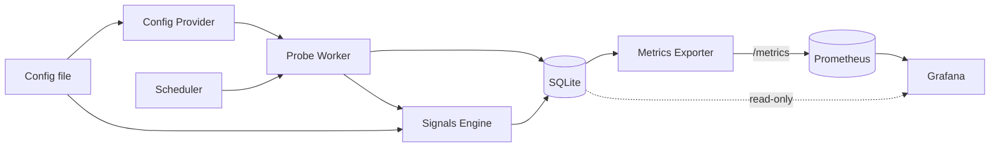

# Connectivity Monitor — Architecture (v0)

## Purpose

A personal-use tool for continuous, multi-path monitoring of the
reachability and integrity of arbitrary internet endpoints. Its job is
to capture raw evidence of how network paths behave — latency, TLS
handshake details, response characteristics, DNS answers, failure
modes — across a user-defined set of routes (direct, via a VPN, via a
DPI-bypass proxy, through a remote jumpbox, etc.) and surface that
evidence continuously through a metrics endpoint and Grafana.

The ethos is borrowed from OONI probe: **capture widely, interpret
later.** This tool is not primarily an alerting system; it is a
diagnostic observatory.

### Pivot context

This project has pivoted twice.

1. **Hackathon → personal.** Originally drafted as a hackathon
   submission ("Operational Continuity Agent") targeting corporate
   SREs: hardcoded RU/EU OpenConnect VPN labels, Mattermost alert
   threading, an LLM agent producing fixed-enum diagnoses. With the
   hackathon off the table, the design was re-pointed at personal use.
2. **Custom frontend → Prometheus + Grafana (2026-06-30).** The
   earlier v0 carried a bespoke SvelteKit dashboard (a target × path
   matrix, a signals browser, native-primitive component work, a CRT
   visual language) plus a hand-rolled HTTP REST + WebSocket API to
   feed it. That surface was the project's single largest sink of
   open-ended effort and stalled the work for months. It is **dropped**
   in favour of an industry-standard observability stack: the service
   exposes a Prometheus **`/metrics`** endpoint, and **Grafana** owns
   all visualization (live dashboards, time-series, the status matrix)
   and alerting. The bespoke REST/WebSocket API and the SvelteKit app
   are gone. See `OBSERVABILITY.md`.

This document is the post-pivot v0 architecture.

## Non-goals for v1

- **LLM integration of any kind.** Qualitative diagnostics come from
  deterministic heuristic rules instead. LLM-authored explanatory
  reports are a candidate later-phase feature.
- **A custom frontend / UI framework.** No SvelteKit, no React, no
  bespoke component work, no in-house dashboard. Visualization is
  Grafana, consuming Prometheus + the SQLite evidence store.
- **A bespoke HTTP REST or WebSocket API.** The only HTTP surface the
  service exposes is the Prometheus scrape endpoint (`/metrics`).
- **The application shipping webhooks, push, or external messaging**
  (Mattermost, Slack, email, ntfy, etc.). Notifications, if wanted,
  are configured in Grafana by the user — the app itself integrates
  none.
- **Alert dampening, on-call workflows, incident management.**
- **Hardcoded knowledge of any specific VPN, proxy, or transport.**
  No `CORPORATE_VPN` path, no `DPI_BYPASS` path. Paths are purely
  user-defined.
- **A fixed diagnosis enum.** Diagnostic outputs are tagged,
  open-ended signals.
- **Cloud deployment, multi-user, authentication.** Single-user,
  locally-run.

## Core concepts

**Target.** An internet endpoint to monitor. Minimally a URL
(protocol + host + path) with a human-readable label. Targets are
**defined in the configuration file**, exactly like paths — declared
once, applied at startup (see `CONFIG_FILE.md`). They are referenced
by name in probe and signal records. (Earlier drafts stored targets
in the database and managed them through dashboard forms; with no UI,
the runtime-mutation justification is gone, and config-file targets
are consistent with config-file paths.)

**Path.** A named route through which the tool reaches the internet.
From the application's perspective, a path is a named SOCKS5 URL (or
the special value "no proxy — use the host's default routing"). Paths
are user-defined; the system ships zero hardcoded labels.
Implementations are out-of-scope for the app itself: the user stands
up whatever they want — a container running OpenConnect+oathtool, a
WireGuard-via-SOCKS sidecar, a remote `ssh -D` tunnel, a bare
shadowsocks server — and tells the tool the SOCKS5 URL plus any
descriptive tags.

**Probe.** A single check of a single target over a single path at a
specific time. Produces a structured outcome: success/failure, timing
breakdown, and a rich JSON payload of raw evidence (DNS answers, TLS
handshake details, response headers, failure mode, optionally body
size/hash). Probes are the atom of everything downstream.

**Signal.** A tagged observation produced by a deterministic rule
evaluating probe data. Signals can be per-probe (e.g. "response
truncated at a suspicious size boundary") or cross-probe (e.g. "TLS
cert fingerprint differs across paths for the same target over the
last N probes"). Signals carry a name, a confidence score, and an
evidence pointer to the probes that triggered them. Signals do not
collapse into a single enum — a target can have several concurrent
active signals, and new rules can be added without schema change.

## Data flow

The flow is one direction: probes and signals are written to SQLite;
the metrics exporter derives current-state gauges/counters from that
store and exposes them at `/metrics`; Prometheus scrapes on its own
interval; Grafana reads Prometheus for time-series and the SQLite file
directly (read-only) for raw evidence drill-ins.

### Probe data flow (server-driven, one direction)

1. The **scheduler** (in-process, via `croner`) fires every
   configured interval. The scheduler enforces no-overlap semantics
   — the next firing is held until the prior handler's Promise
   settles — to keep slow probes from queuing on top of each other.
2. For each target, the **probe worker** dispatches one probe per
   configured path, concurrently. Each probe opens a connection
   through its path's SOCKS5 URL (or direct), performs the configured
   check types (HTTP GET at minimum; optionally DNS-only lookup,
   TCP-connect-only), captures raw evidence, and returns an outcome.
3. Each probe outcome is persisted to the `probes` table: hot
   columns (target name, path, check type, timestamp, runtime, reached
   stage, first failure code, …) plus the full payload as a JSON
   blob. See `STORAGE_SCHEMA.md` for the column-level detail and
   `PROBE_PAYLOAD.md` for the payload structure.
4. The **signals engine** evaluates the new probe — along with recent
   history for that target — against its rule set, persisting any
   fresh signals.
5. The **metrics exporter** reflects the latest persisted state. On
   each Prometheus scrape of `/metrics` it emits the current gauges
   and counters (probe up/down, latency, reached stage, active signals
   by rule, …) derived from SQLite. Prometheus stores the time-series;
   Grafana renders dashboards and evaluates alert rules over them. See
   `OBSERVABILITY.md` for the metric inventory and dashboard set.

### Configuration flow (inbound)

There is a single inbound channel: the **config file**. Path
definitions, target definitions, signal-rule tuning constants
(thresholds, suspicious-size boundaries, time windows), cadence
defaults, and the metrics-exporter bind settings are all read from a
layered TOML config at startup. File-based by design: nothing in v1 is
managed through a UI, and tuning is a deliberate act, not a runtime
knob. Reload semantics: v0 has none — restart to apply (see
`CONFIG_FILE.md`).

## Component architecture

All application components live in a single process. Prometheus and
Grafana are separate, standard services (see "Deployment shape").

**Probe engine.** Runs scheduled probes. Holds no persistent state
beyond in-flight probe futures. Takes a `(target, path)` as input;
produces a probe outcome. `http_get` is backed by Playwright (see
`PROBE_PAYLOAD.md`); `dns_lookup` and `tcp_connect` go through
`node:dns` and `node:net` respectively. Check types (`http_get`,
`dns_lookup`, `tcp_connect`) are the extensibility seam.

**Config provider.** Reads path and target definitions (plus all
tuning) from the layered config file at startup and exposes the live
lists to the probe engine and signals engine. The app does not start,
stop, or health-check the proxy processes themselves — that is the
user's responsibility. Reference deployment recipes ship alongside as
worked examples in `PATH_DEPLOYMENTS.md`, not as runtime dependencies.

**Storage.** SQLite via `node:sqlite`. Two tables for probes (with a
JSON payload column absorbing schema evolution) and signals, plus a
`schema_migrations` sidecar. Schema, indexes, retention policy, and
lifecycle details in `STORAGE_SCHEMA.md`. Neither paths nor targets
are stored in the database in v1 — both live in the config file and
are re-read on restart; probes and signals reference them by name. The
database file is opened in WAL mode so Grafana's SQLite datasource can
read it concurrently with the engine's writes.

**Signals engine.** A set of pure-ish async functions, each
evaluating some slice of probe data and returning 0..n signals
(fire / clear / no-op). Runs after each probe. Rules are plain
TypeScript modules under `src/signals/rules/`; adding a rule means
adding a file — auto-discovered at startup, no central registry.
All thresholds and confidence values live in the config file, not
in code. Catalogue and contract in `SIGNAL_RULES.md`.

**Metrics exporter.** A minimal HTTP endpoint (`node:http`, no web
framework) serving Prometheus text-format metrics at `/metrics`,
built on `@prometheus-io/client`. It derives a bounded set of gauges and
counters — probe up/down, last latency and a latency histogram,
reached-stage, probe/error counts, active-signal state and confidence
— from the latest persisted state (seeded at startup, updated
in-process; not re-queried per scrape). Strict label-cardinality
discipline (target, path, check_type, rule, outcome, code only —
never probe ids, URLs, or timestamps as labels).
Full contract and metric inventory in `OBSERVABILITY.md`.

**Visualization — Grafana (external).** Grafana is the entire UI. It
reads two data sources: **Prometheus** (the scraped time-series — the
status matrix via state-timeline/status-history panels, latency
trends, signal activity) and the **SQLite** evidence store, read-only,
for raw-probe drill-in tables (per-hop detail, cert chains, body
shape, the full payload JSON). Alerting, if the user wants it, is
configured in Grafana. Datasource definitions and dashboard JSON are
committed to the repo and provisioned into Grafana (see
`OBSERVABILITY.md`); Grafana is not part of the application process.

## Technology choices

**Node.js 26 runtime.** Built-in `node:sqlite` (stable since Node
24, no `better-sqlite3` bundling pain), stable Temporal API for
datetime handling, native WHATWG `fetch`, built-in test runner, and
the broader ecosystem maturity that comes with Node. TypeScript
throughout (via `--experimental-strip-types`, `tsx`, or pre-compile
depending on deployment shape). An earlier draft of this spec chose
Bun for some of the same affordances; Node 26 closed the gap that
originally favored Bun, and the broader ecosystem tipped the
balance.

**A single Node service — no web framework.** One repo, one process:
the probe engine, the signals engine, the SQLite store, and the
metrics exporter all live inside one Node program. The only HTTP it
serves is `/metrics`, which needs nothing more than `node:http` +
`@prometheus-io/client`. The earlier SvelteKit-monolith rationale (form actions,
a component framework for the matrix/time-series views) is moot now
that Grafana owns visualization. `adapter-node`, `ws`, the SvelteKit
build — all dropped.

**`node:sqlite`.** Built-in to Node since v22 (stable in v24+),
single-file DB, zero deployment friction, more than fast enough for
the probe throughput at hand. WAL mode lets Grafana's SQLite datasource
read the same file concurrently with the engine's writes.

**`@prometheus-io/client`.** The Prometheus project's official Node
client; `prom-client` was deprecated in its favour in 2026-08. Provides the registry, gauge/counter/histogram primitives
(label names typed per metric), and the text exposition format.
Zero-config integration with Prometheus scraping.

**Prometheus + Grafana.** The visualization and alerting stack, run
as standard containers. Prometheus scrapes `/metrics` and stores the
time-series; Grafana dashboards and alert rules sit on top. This
trades an unbounded bespoke-frontend effort for a bounded, finishable
integration — and delivers the time-series views (latency over time,
uptime) that the custom dashboard had deferred to "post-MVP," for
free. See `OBSERVABILITY.md`.

**Playwright.** Headless browser automation for `http_get` probes
(Chromium / Firefox / WebKit). Picked over `curl-impersonate` and
plain `fetch` because the browser *is* the browser — no
fingerprint-spoofing shim — and CDP gives structured network events
natively. Deployment cost: ~200 MB browser bundle. Acceptable for a
home-server tool. See `PROBE_PAYLOAD.md` for the per-hop event
shape it produces.

**Other notable dependencies.** [`croner`](https://github.com/Hexagon/croner)
for in-process cron-style scheduling with overlap protection.
[Zod v4](https://zod.dev) for validating the merged config at
startup (fatal on failure) — no longer an API-schema concern, just
config sanity.

## Deployment shape

Three pieces, plus the user's own proxies:

1. **The Node service** — probe engine + signals engine + SQLite +
   `/metrics`. Runs locally or on a small VPS. Reads one config file,
   reads/writes one SQLite file, serves `/metrics` on a port.
2. **Prometheus** — scrapes `/metrics` on its interval; stores the
   time-series; ships a committed `prometheus.yml` scrape config.
3. **Grafana** — reads Prometheus and the SQLite file (read-only);
   datasources and dashboards are provisioned from committed files.

A reference `docker-compose.yml` brings up all three (the SQLite file
bind-mounted into both the service and Grafana). Separately, the user
runs whatever proxy containers or services they want; each exposes a
SOCKS5 port that a path definition references. The tool does not
orchestrate those containers.

Reference proxy deployments (an OpenConnect+oathtool Dockerfile, a
WireGuard-via-SOCKS recipe, etc.) ship alongside as worked examples,
not dependencies.

## Sub-documents

Specific areas factored out of this document for independent
iteration. Each is its own file.

### Written

- **Reference path deployments** (`PATH_DEPLOYMENTS.md`). The path
  contract, the `role` / `tags` schema, DNS policy default, secrets-
  handling patterns, and a cookbook of Dockerfiles + compose recipes
  for recommended proxy setups (OpenConnect+oathtool+pass, SpoofDPI,
  Tor, …).
- **Probe payload specification** (`PROBE_PAYLOAD.md`). The three
  check types (`http_get` / `dns_lookup` / `tcp_connect`), the
  per-hop JSON shape of `http_get` (Playwright-native per-hop
  structure, OONI influence at the per-op record level), flat shapes
  for the simpler two, the `reached_stage` + `termination_mode` +
  per-op `failure` factual model, body-shape signals, and the
  error-code taxonomy.
- **Storage schema** (`STORAGE_SCHEMA.md`). SQLite tables for
  `probes` and `signals` (paths and targets stay in config). Hot
  columns + JSON payload blob. Signal lifecycle (active / cleared,
  rule-responsible clearing). 30-day retention, no rollups in v1.
  TEXT ISO 8601 datetimes.
- **Signal rule catalogue** (`SIGNAL_RULES.md`). The `Rule`
  contract (pure-ish async function, three-outcome model), the
  storage reader API rules use to query history, the v0 catalogue
  of rules across several categories (TLS / DNS interference, target-
  initiated unavailability, reachability, cross-path comparison,
  perf), and an "adding your own rule" appendix with a worked
  example. Rules auto-discovered from `src/signals/rules/`. All
  thresholds and confidence values are config (under
  `rules.<rule_name>.*`), not code constants.
- **Configuration file format** (`CONFIG_FILE.md`). TOML, layered
  (`config/default.toml` → `<NODE_ENV>.toml` → `local.toml`),
  node-config-style. Schema covers metrics exporter / storage /
  scheduler / probe defaults / body-shape detection / **paths /
  targets** / per-rule config. Secrets stay out; v0 has no
  hot-reload (restart to apply).
- **Observability** (`OBSERVABILITY.md`). The `/metrics` Prometheus
  endpoint and its metric inventory + label-cardinality discipline;
  Grafana data sources (Prometheus + the SQLite evidence store);
  the dashboard inventory (status matrix, latency time-series, signal
  table, raw-probe drill-in); Grafana-native alerting; and the
  committed provisioning files (`prometheus.yml`, Grafana datasources
  and dashboards).
- **Tooling and conventions** (`TOOLING.md`). Developer-side
  toolchain — pnpm, TypeScript strict, ESLint 10+ flat config,
  Prettier, markdownlint-cli2, Vitest. Conventional Commits via
  commitlint with a project-specific scope list. Native Git hooks via
  `core.hooksPath` + `.githooks/` + a `prepare` script (no lefthook /
  husky / lint-staged). Push policy: no agent autopush. CI / Renovate
  / spellcheck explicitly out of scope.

All sub-documents are drafted (v0). `CLAUDE.md` — consolidating the
durable agent-facing conventions — is the remaining documentation
artifact before/alongside implementation.

## Out of scope entirely

Multi-user operation. Authentication. Cloud-native deployment. A
custom frontend or in-house dashboard of any kind. Any alerting story
the application itself owns (Grafana handles alerting externally).
LLM integration. Long-term time-series analytics beyond what
Prometheus retention and Grafana surface directly.

---

*Status: v0 draft. Expect revisions as sub-documents surface
decisions that ripple upward.*
