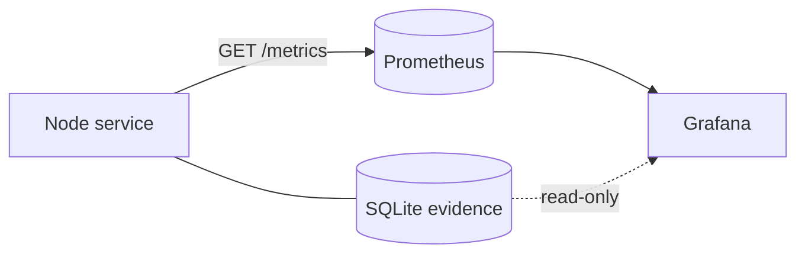

# Observability — Metrics & Grafana (v0)

## What this document is

A companion to the other sub-documents. It specifies the application's
**only** external interface and its visualization layer:

- The Prometheus **`/metrics`** endpoint — transport, derivation
  semantics, the full metric inventory, and label-cardinality
  discipline.
- The **Grafana** setup — data sources (Prometheus + the SQLite
  evidence store), the dashboard inventory, and alerting.
- The **committed provisioning** that wires it together
  (`prometheus.yml`, Grafana datasources + dashboards, a reference
  `docker-compose.yml`).

This document replaces the former `API.md`. The bespoke HTTP REST API
and the WebSocket delta channel it described are **removed** — they
existed only to feed the custom SvelteKit dashboard, which no longer
exists (see `ARCHITECTURE.md`, "Pivot context"). The single HTTP
surface the service now exposes is `/metrics`.

## Topology



- The **service** writes probes/signals to SQLite and exposes current
  state at `/metrics`.
- **Prometheus** scrapes `/metrics` on its interval and stores the
  time-series.
- **Grafana** reads **Prometheus** for everything graph-shaped
  (status matrix, latency trends, signal activity) and reads the
  **SQLite** file directly (read-only) for raw-evidence drill-ins that
  are too high-cardinality / blob-shaped to be metrics.

Numbers go through Prometheus; evidence comes straight from SQLite.
That split is the whole design.

## The `/metrics` endpoint

### Transport

A minimal HTTP listener (`node:http`, no web framework) serving the
Prometheus text exposition format, built on `@prometheus-io/client`. Bind host,
port, and path come from `[metrics]` in the config (see
`CONFIG_FILE.md`); defaults to `127.0.0.1:9974/metrics`.

```
GET /metrics  →  200, Content-Type: text/plain; version=0.0.4
```

No auth (localhost-bound by default). If exposed beyond localhost,
front it with a reverse proxy — same posture as Prometheus and
Grafana themselves.

### Derivation semantics

How each metric is kept current matters, because Prometheus scrapes on
its own clock, independent of probe cadence:

- **Gauges** (`*_up`, `*_reached_stage`, `*_latency_ms`,
  `*_last_timestamp_seconds`, `signal_active`, `signal_confidence`)
  reflect **current state**. At startup the exporter **seeds** them
  from the latest persisted rows in SQLite (the
  `idx_probes_target_path_time` "latest per `(target, path,
  check_type)`" query, and the active-signals query). Thereafter they
  are updated **in-process** on each probe insertion and signal
  transition. A scrape therefore just serialises the registry — **no
  SQLite query per scrape.**
- **Counters** (`*_total`) accumulate **in-process**, incremented as
  probes are written and errors observed. They reset to zero on
  process restart; Prometheus handles counter resets natively
  (`rate()`/`increase()` are reset-aware), so no seeding is needed.

This means metrics survive Prometheus restarts (state is re-seeded
from SQLite on the service's own startup) and tolerate service
restarts (counters reset cleanly, gauges re-seed).

## Metric inventory

All metrics are prefixed `nba_`. Types and labels are fixed; values
and derivations are documented per metric.

### Build / meta

```
# gauge, always 1; carries build metadata as labels
nba_build_info{version, node_version} 1
```

### Probe metrics

| Metric | Type | Labels | Meaning |
|---|---|---|---|
| `nba_probe_up` | gauge | `target,path,check_type` | `1` when the last probe reached `complete` with no `first_failure_code`; else `0`. |
| `nba_probe_reached_stage` | gauge | `target,path,check_type` | Ordinal of the last probe's `reached_stage` (mapping below). Enables a state-timeline of how far probes get. |
| `nba_probe_latency_ms` | gauge | `target,path,check_type` | Last probe's `runtime_ms`. |
| `nba_probe_duration_ms` | histogram | `target,path,check_type` | Distribution of `runtime_ms` (for percentiles / latency trends over time). |
| `nba_probe_last_timestamp_seconds` | gauge | `target,path,check_type` | Unix time of the last probe — drives freshness/staleness alerts. |
| `nba_probes_total` | counter | `target,path,check_type,outcome` | Count of probes by `outcome ∈ {success, failure}`. |
| `nba_probe_errors_total` | counter | `target,path,check_type,code` | Count of probes by `first_failure_code` (`code` omitted/“none” excluded). |

**`reached_stage` ordinal mapping** (also shipped as a Grafana value
mapping):

```
0 = dns            3 = http_request    6 = complete
1 = tcp_connect    4 = http_response
2 = tls_handshake  5 = body_transfer
```

### Signal metrics

Keyed to the storage model — at most one active signal per
`(target, rule_name)` (see `STORAGE_SCHEMA.md`):

| Metric | Type | Labels | Meaning |
|---|---|---|---|
| `nba_signal_active` | gauge | `rule,target` | `1` while a signal is active for `(target, rule)`; `0`/absent when cleared. |
| `nba_signal_confidence` | gauge | `rule,target` | The active signal's confidence (`0.0–1.0`); absent when no active signal. |

The count of active signals (overall or per rule) is derived in
Grafana with `count(nba_signal_active == 1)` / `... by (rule)` — no
dedicated metric. Path is **not** a signal label: it isn't part of the
signal key; when a signal is path-attributable that detail lives in
its `evidence` JSON, reachable via the SQLite drill-in.

### Example exposition

```
# HELP nba_probe_up Last probe reached complete with no failure.
# TYPE nba_probe_up gauge
nba_probe_up{target="rutracker.org",path="direct",check_type="http_get"} 0
nba_probe_up{target="rutracker.org",path="spoofdpi",check_type="http_get"} 1
nba_probe_latency_ms{target="rutracker.org",path="spoofdpi",check_type="http_get"} 288
nba_probe_reached_stage{target="rutracker.org",path="direct",check_type="http_get"} 2
nba_signal_active{rule="tls_handshake_hang",target="rutracker.org"} 1
nba_signal_confidence{rule="tls_handshake_hang",target="rutracker.org"} 0.82
```

## Label-cardinality discipline

The cardinality ceiling is `targets × paths × check_types` — bounded
and small for a personal tool (tens, not thousands of series). Hold
the line:

- **Allowed labels, full stop:** `target`, `path`, `check_type`,
  `rule`, `outcome`, `code`. All are low-cardinality, bounded by config
  or by fixed enums. (Probe stage is **not** a label — it is carried as
  the gauge *value* of `nba_probe_reached_stage` via the ordinal
  mapping above.)
- **Never a label:** probe id, signal id, timestamps, full URLs, body
  snippets, latency values, IP addresses, free-form evidence. Those
  are evidence — they live in SQLite, queried by Grafana's SQLite
  datasource, never exploded into metric series.
- `target` is the configured target **name**, not its URL.

If a future need seems to want a high-cardinality label, that is the
signal to reach for the SQLite datasource instead.

## Grafana

### Data sources (provisioned)

1. **Prometheus** — the primary source; everything time-series.
2. **SQLite** — the evidence store, **read-only**, via the
   `frser-sqlite-datasource` community plugin pointed at the same
   `probes.db`. Safe to read concurrently with the engine's writes
   because the DB is opened in WAL mode (see `STORAGE_SCHEMA.md`).

Both are defined in `grafana/provisioning/datasources/*.yaml` so a
fresh Grafana comes up wired with zero clicks.

### Dashboard inventory

Committed as JSON under `grafana/dashboards/`:

1. **Status matrix** — the signature view. Target rows × path columns,
   each cell coloured by the current `nba_probe_up` /
   `nba_probe_reached_stage`. Built as a **status-history** /
   **state-timeline** panel (or a table with value-mapped cell
   colouring): green = `complete`, amber = a partial stage, red =
   `down`, grey = stale/unknown. This is what the bespoke matrix view
   was for — now a stock Grafana panel.
2. **Latency over time** — `nba_probe_latency_ms` (and
   `histogram_quantile()` over `nba_probe_duration_ms`) per
   `(target, path)`. The time-series view the custom dashboard had
   deferred to post-MVP, available out of the box.
3. **Signal activity** — a state-timeline of `nba_signal_active` by
   `(rule, target)`, plus a **SQLite table panel** listing currently
   active signals with their `confidence`, `fired_at`, and `evidence`
   JSON (rule → target → evidence, the rich view metrics can't carry).
4. **Probe drill-in (evidence)** — a SQLite table panel over `probes`,
   filtered by dashboard variables (`$target`, `$path`, time range),
   surfacing hot columns plus `json_extract()` of interesting payload
   fields, with the full payload available for inspection. This
   replaces the bespoke per-probe drawer.
5. **Freshness** — `time() - nba_probe_last_timestamp_seconds` per
   cell, to spot a path/target whose probes have silently stopped.

### Alerting (optional, Grafana-owned)

The application ships no alerting. Grafana's unified alerting can sit
on the same metrics if the user wants it — examples:

- `nba_probe_up == 0` for 5m → a target/path is down.
- `nba_signal_active == 1` → a diagnostic signal is firing.
- `time() - nba_probe_last_timestamp_seconds > 2 × cadence` → probes
  for a cell have stalled.

Notification channels (email, ntfy, Telegram, …) are configured by the
user inside Grafana. The app integrates none — consistent with the
non-goals in `ARCHITECTURE.md`.

## Provisioning files (committed)

```
prometheus.yml                              # scrape config
grafana/provisioning/datasources/*.yaml     # Prometheus + SQLite
grafana/provisioning/dashboards/*.yaml       # dashboard providers
grafana/dashboards/*.json                    # the dashboards above
docker-compose.yml                           # service + Prometheus + Grafana
```

Minimal scrape config:

```yaml
# prometheus.yml
global:
  scrape_interval: 30s        # align with, or just under, probe cadence
scrape_configs:
  - job_name: nerd-butthurt-alert
    static_configs:
      - targets: ["host.docker.internal:9974"]   # the service /metrics
```

Prometheus datasource provisioning:

```yaml
# grafana/provisioning/datasources/prometheus.yaml
apiVersion: 1
datasources:
  - name: Prometheus
    type: prometheus
    access: proxy
    url: http://prometheus:9090
    isDefault: true
```

SQLite datasource provisioning (read-only evidence):

```yaml
# grafana/provisioning/datasources/sqlite.yaml
apiVersion: 1
datasources:
  - name: SQLite (evidence)
    type: frser-sqlite-datasource
    jsonData:
      path: /data/probes.db        # bind-mounted read-only
```

The reference `docker-compose.yml` runs the Node service, Prometheus,
and Grafana, bind-mounting `probes.db` into both the service
(read-write) and Grafana (read-only). The user's proxy containers are
separate (see `PATH_DEPLOYMENTS.md`).

## Relationship to the probe cadence

`scrape_interval` should be at or just under the fastest probe cadence
(`[scheduler]` in `CONFIG_FILE.md`). Scraping faster than probes run
only resamples unchanged gauges (harmless); scraping much slower risks
missing a short-lived state between probes. 30s default pairs with the
default cadences.

## Deferred / open

- **Histogram bucket tuning.** `nba_probe_duration_ms` buckets start
  from a generic latency set; tune to observed distributions once
  there's real data.
- **Recording rules.** If common Grafana queries (e.g. per-target
  uptime ratios) get heavy, precompute them as Prometheus recording
  rules. Not needed at this scale.
- **SQLite datasource plugin pin.** `frser-sqlite-datasource` is a
  community plugin; pin a version in Grafana provisioning and
  re-evaluate if maintenance lapses. A read-only JSON endpoint on the
  service is the fallback if the plugin ever becomes a problem.
- **Exposure / auth.** `/metrics`, Prometheus, and Grafana all bind
  locally by default; a public deployment fronts them with a reverse
  proxy + auth. Out of v0 scope.
- **Long-term retention.** Prometheus TSDB retention vs. SQLite's
  30-day raw retention are independent knobs; revisit if long-horizon
  trends matter.

---

*Status: v0 draft. Replaces the former `API.md`.*
